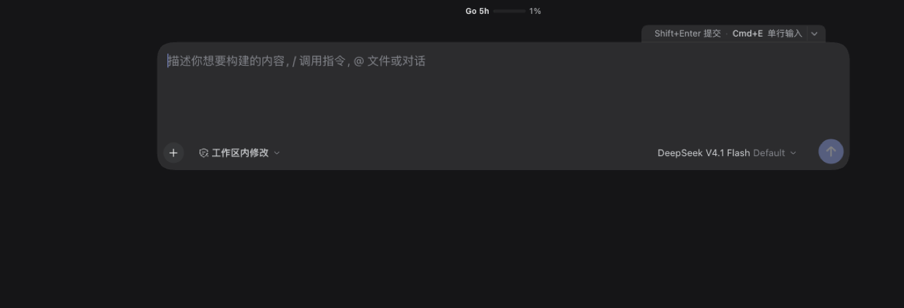
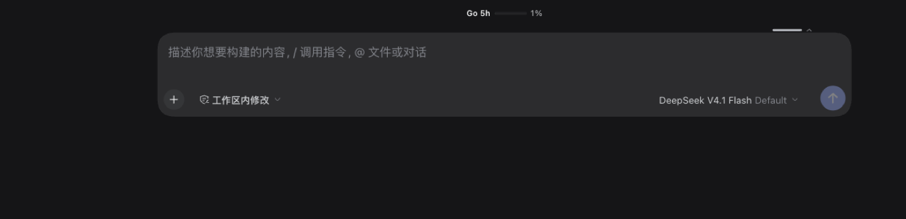
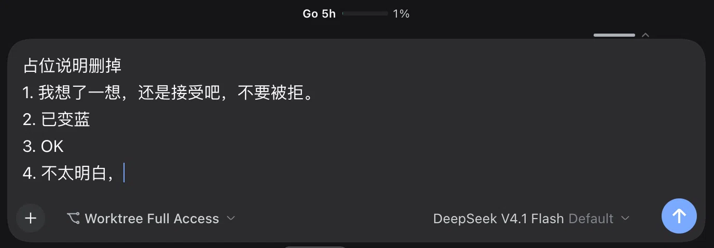
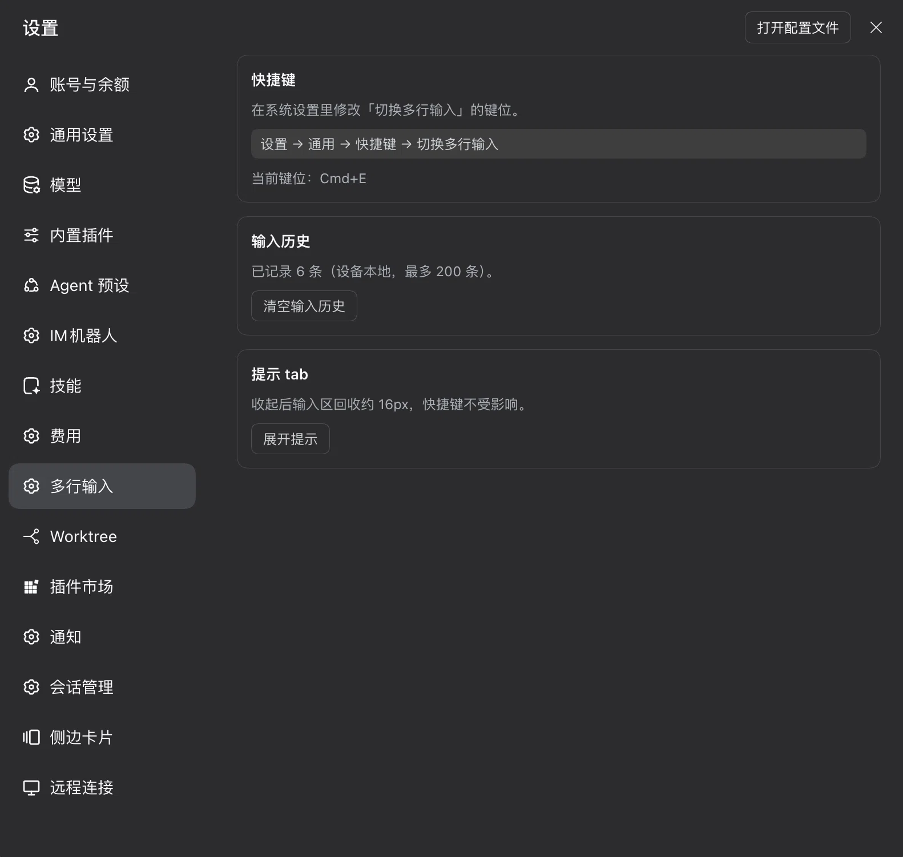

# dsh-multiline-input

> 官网 / Website: <https://dsh.zlmix.com/multiline-input/>

[npm](https://www.npmjs.com/package/dsh-multiline-input) · [GitHub](https://github.com/ZilongYang/dsh-multiline-input) · [Release v0.2.2](https://github.com/ZilongYang/dsh-multiline-input/releases/tag/v0.2.2) · [市场 PR #9938](https://github.com/awesome-dsh-plugin/awesome-dsh-plugin/pull/9938)

把 DeepSeek Harness 的对话输入框在**单行 / 多行**之间切换的 Web 客户端插件。

- 默认快捷键 **Cmd+E（macOS）/ Ctrl+E（Windows / Linux）**；输入框上沿有一个与输入框同底色的小 **tab** 显示当前快捷键与目标模式，点击即可切换。
- 多行模式输入框默认 **4 行高**，**起始行数 3 / 4 / 5 可在设置里改**；内容变多自动长高，到原生 336px 上限后滚动。
- 多行模式 **Enter 换行、Shift+Enter 发送**；单行模式保持 DSH 原生行为（Enter 发送、Shift+Enter 换行）。
- 输入框上沿的 tab 可**收起成一条 8px 细线**（3px 粗、带淡色 chevron，热区约 116×20px），把高度让给正文；点击细线随时恢复，收起状态按设备记住。
- 提交过的文字会记入**设备侧输入历史**：单行模式 `↑` / `↓`、多行模式 `Shift+↑` / `Shift+↓` 回看并替换，`Esc` 还原浏览前草稿；失败/被拒的提交也会保留，方便直接重发。
- 快捷键可在 **设置 → 通用 → 快捷键**里改成任意组合（冲突校验、恢复默认都由 DSH 官方界面负责）。
- **默认全局共享一个模式**（在哪个会话切换都一起变）；想要「每个会话各自记住」，在设置页把「按会话记忆」打开即可，关掉立刻回到共享模式。
- 界面文案**跟随 DSH 语言**：内置 zh / en / ja / es / fr / de / ru / pt 八套（DSH 0.2.2 起支持的全部语言）。










## 安装

```sh
# 市场 / CLI 管理的 profile
dsh plugin --profile <profile> add dsh-multiline-input

# 或在应用内「插件」页搜索 / 用绝对路径安装后启用
```

桌面版使用的 `desktop` profile 由应用独占（`dsh plugin --profile desktop` 会被拒绝），请在应用「插件」页安装或手动 link：

```sh
cd ~/.dsh/profiles/desktop
pnpm add link:/absolute/path/to/dsh-multiline-input
# 再把 "dsh-multiline-input" 追加到 package.json 的 dsh.profile.bundles
```

启用后刷新页面即可；插件清单变化不需要重启应用。

**卸载**：插件页关闭 / 卸载，或 `dsh plugin --profile <profile> remove dsh-multiline-input`。

## 使用

| 操作 | 单行模式 | 多行模式 |
|---|---|---|
| `Enter` | 发送 | 换行 |
| `Shift+Enter` | 换行 | 发送 |
| `Cmd/Ctrl+Enter` | 加速提交（不变） | 加速提交（不变） |
| `↑` / `↓` | 浏览输入历史 | 原生移动光标 |
| `Shift+↑` / `Shift+↓` | 原生扩展选择 | 浏览输入历史 |
| `Esc`（浏览中） | 还原浏览前草稿 | 还原浏览前草稿 |
| `/`、`@` 菜单打开时的 `Enter` | 选中菜单项 | 选中菜单项 |
| 输入法候选态的 `Enter` | 交给输入法 | 交给输入法 |

- 按 `Cmd+E` / `Ctrl+E`（或点击 tab）在两种模式间循环；切换不清空草稿、不抢焦点。
- tab **默认常驻**，输入文字时也不隐藏；多行时显示 `Shift+Enter 提交 · Cmd+E 单行输入`，单行时显示 `Cmd+E 多行输入`；浏览历史时标签位改为 `历史 n/m`。
- tab 是输入框上方**独立的一行**：展开态 24px；点击右侧收起按钮变成 8px 细线（仍在流内，输入区回收约 16px）；细线 3px 粗、右侧带淡色向上 chevron，点击热区约 116×20px，hover 出现浅色胶囊底并把线加亮加长，点击即可恢复。无论展开还是收起，目标条、待办、队列、额度横条等 DSH 卡片都排在它上面，不会被遮住。
- 收起/展开状态按设备持久化（`dsh-multiline-input.hint.v1`）；收起后 `Cmd/Ctrl+E` 仍照常切换。

### 插件配置页

打开 **设置（`Cmd+,`）→ 左侧导航「多行输入」**（主入口），或在「插件」页 → `dsh-multiline-input` → 「多行输入 >」行进入（次入口），可以看到：

- **快捷键**：当前生效键位、「打开设置」按钮（尽力打开系统设置面板）与「设置 → 通用 → 快捷键 → 切换多行输入」路径；
- **起始行数**：3 / 4 / 5 行三选一（设备本地，多行模式下输入框的最小高度）；
- **默认模式**：单行 / 多行二选一（全局共享模式下就是当前模式；按会话模式下是新会话的起点）；
- **按会话记忆**：开关（默认关闭）+ 打开时的「清除所有会话记忆」按钮；
- **输入历史**：已记录条数、二次确认的「清空输入历史」；
- **提示 tab**：一键收起 / 展开提示。

### 输入历史

- **提交时就入历史**（排队 / steer 也一样，发完马上能 `↑` 到）；`/` 命令、空提交、超过 16000 字符的单条不记；发送失败 / 被拒的消息也保留，方便直接重发。
- 设备侧 `localStorage`（`dsh-multiline-input.history.v1`）全局一份，按最近提交排序，完全相同的文字只保留一条（重复提交当前最新一条时不重复写入，旧条目再次提交则移到最前）；上限 200 条 / 10 万字符。
- 浏览时首次 `↑` 会把当前草稿存起来：`Esc` 或在新条目上再按 `↓` 会还原并退出浏览；直接打字 / 粘贴 / 剪切则退出浏览、保留当前文字；提交后从头开始。
- **清空入口**：在「设置 → 通用 → 快捷键」搜索「清空输入历史」，给 `multiline-input.clear-history` 绑一个组合即可（默认不占用任何键）。
- 历史是设备本地明文，可能包含敏感内容；换设备不会同步，多窗口之间也不实时同步。

## 修改快捷键

1. 打开 **设置 → 通用 → 快捷键**；
2. 搜索「多行输入」（命令名：**切换多行输入**，id `multiline-input.toggle`）；
3. 点击右侧键位进入录制，按下新组合即可；冲突时官方界面会提示，可随时恢复默认。

tab 实时跟随当前生效的组合；把绑定清空后只显示「多行输入 / 单行输入」，点击仍可切换。

同一个快捷键列表里还有一条默认不绑定的命令 **清空输入历史**（`multiline-input.clear-history`），需要时自行指定组合即可。

## 与相近插件的区别

| 插件 | 它做什么 | 本插件 |
|---|---|---|
| `dsh-composer-expand` | 工具行按钮把输入框撑到 70vh | 双模式 + 快捷键 + Enter/Shift+Enter 互换 + 可收起 tab + 输入历史 |
| `dsh-fullscreen-input` | 另开全屏面板写多行，Enter 换行、Ctrl+Enter 发送 | 内联在原生输入框，多行时 Shift+Enter 发送（带输入法保护） |
| `dsh-ctrl-enter-submit` | 全局把 Enter 改成换行、Ctrl/Cmd+Enter 发送 | 单行保持原生 Enter 发送，多行才交换 |
| `dsh-composer-ux` | 可配置发送/换行键位 + 右键菜单 + 快捷指令面板 | 只专注输入模式与高度 |
| `dsh-keyboard-manager` | Ctrl+Q / **Ctrl+E** / Ctrl+S 切栏、开设置 | Windows/Linux 上它的 Ctrl+E 与本插件默认冲突；可在设置里改键（macOS 本插件用 Cmd+E，不冲突） |

## 实现说明

插件遵守 DSH 的第三方客户端插件契约（`dsh.client` + `dsh.bundle.patch`），Host 半只保留一个可安装 / 启停的 bundle row，功能全部在 `client.js`：

- **模式状态**：`localStorage['dsh-multiline-input.mode.v1']` 是共享（默认）模式；开关 `dsh-multiline-input.session-memory.v1`（`on` / `off`，**默认 off**）打开后，`dsh-multiline-input.session-mode.v1` 才参与计算 —— 它存**逐会话覆盖值**（`{ version: 1, sessions: [{ id, mode }] }`，最近 40 个会话 LRU 截断）。dock 槽是 session 作用域，`inject(sessionId => …)` 让每个输入区挂载时 adopt「生效模式」（开关关 = 共享模式；开关开 = 该会话覆盖值或共享默认），投影为 `<html data-dsh-multiline-input="multi">`。切换在开关关时写共享模式、开时只写当前会话（hero 态写共享默认值）；Enter 接管、↑↓ 历史、tab 文案都读生效模式；
- **高度**：一条 CSS 规则给 `[data-composer-card] [data-composer-input]` 设 `min-height: calc(var(--dmi-min-lines, 4) * 1lh + 8px)`（`@supports` 回退 `calc(var(--dmi-min-lines, 4) * 24px + 8px)`），行数由 `<html>` 上的 `--dmi-min-lines` 控制（`localStorage['dsh-multiline-input.lines.v1']`，3 / 4 / 5），改设置不需要重建样式表、也不碰 DSH 的滚动上限；选择器同时匹配 `contenteditable="true"` 与**只读提交相位**（`data-phase` 不是 `plain` 时，如 0.2.2 的 `sending`）——0.2.2 起普通消息在等待 Host 接受期间编辑器是 `contenteditable="false"`，只匹配前者会让高度在每次发送时塌回宿主的 36px 再弹回；
- **tab 提示**：注册到 `conversation.input.dock` 座位（`order: 1000`，排在 todo 0 / 额度横条 5 / 目标条 10 / 队列 20 之后），成为输入卡片正上方**独立的一行**：展开 24px、收起 8px，宽度与卡片同列、tab 右对齐到卡片右边缘；`margin-bottom` 吃掉栈的行距（dock 态 6px、hero 态 8px，运行时按实际 `row-gap` 同步），让 tab 底边与卡片上沿齐平、视觉上仍是「卡片肩上的 tab」，但因为占位而**不可能压到任何上方卡片**；收起态靠同一行 8px 高度 + 抵消行距把输入区回收约 16px。
- 旧实现走 `conversation.input.overlay` 浮层（`bottom: 100%` + `z-index: 2`），会盖住目标条右侧的文案与暂停 / 编辑 / 清除按钮；
- **输入历史**：轮询 `useInput(s => s.phase/draft)` 与 `useSession(s => s.pendingSubmissions)`。0.2.2-rc.1 起普通消息走 `sending` 冻结相位（草稿冻结、编辑器只读、Host 接受后 `pendingSubmissions` 增长才清空），所以提交时先捕获冻结草稿、待回显出现时写入 `localStorage`；0.2.1-rc.5 及更早没有 `sending`，回显是乐观的（提交时出现、失败时移除并回填草稿），走「捕获草稿 → 回显退休且草稿未回填才写入」的兜底路径。两条路径由「是否见过 `sending`」在运行时选定，失败 / 被拒的提交都不入历史。浏览时通过公开的 `inputActions.setDraft()` 替换草稿（`setDraft` 会合并进撤销历史），方向键手势仍在 document 捕获阶段接管。带引用（quote）发送时，引用会以 Markdown 块引用文本进入草稿字符串，因此同样被记入历史；召回时 `setDraft` 只写纯文本，引用 chip 不会复原。
- **Enter / Shift+Enter**：在 document 捕获阶段拦下多行模式下的 `Enter`，向编辑器重放一个翻转了 `shiftKey` 的合成按键——仍由 DSH 自己的 composer keymap 决定「换行」还是「提交」，撤销历史、输入法保护、busy-enter（queue/steer）、菜单仲裁全部保持原逻辑；
- **快捷键**：通过 `ctx.shortcuts.register()` 注册命令，编辑与持久化完全交给 DSH。

源码依据（DSH `0.2.2-rc.1`，commit `66491b05`；`0.2.1-rc.5` 契约同读于 `b830ec95`；2026-11-15 已对照**本机安装的 0.2.2-rc.3 构建产物**逐锚点复核，见 [兼容性核查](docs/COMPAT-2026-11-15-dsh-0.2.2-rc.3.md)）：

| 契约 | 源码文件 |
|---|---|
| 输入卡片 / 覆盖层锚点 | `packages/client/ui-conversation/src/client/skeleton/InputBar.tsx`、`InputBar.module.css` |
| composer 卡片栈（`conversation.input.dock`） | `packages/client/ui-conversation/src/client/skeleton/ConversationContent.tsx`、`ConversationRoot.module.css` |
| 可编辑面 / 提交相位 | `packages/client/ui-conversation/src/client/input/editor/DraftEditor.tsx`、`ComposerContentEditable.tsx`、`input/machine.ts` |
| Enter 语义 | `packages/client/ui-conversation/src/client/input/editor/keymap.ts` |
| 引用（quote）投影 | `packages/client/ui-conversation/src/client/input/editor/QuoteNode.tsx`、`input/editor/projection.ts` |
| 公开输入动作面 | `packages/client/ui-conversation/src/client/contract/input.ts` |
| 座位与标准 props | `packages/client/ui-conversation/src/client/contract/slots.ts`、`packages/extensions/cordis-client-runner/src/client/slot-catalog.ts` |
| 触发菜单锚点 | `packages/client/ui-input-trigger/src/client/MenuView.tsx`（`data-trigger-menu` + 内部 `role="listbox"`） |
| 快捷键命令契约 | `packages/client/shortcuts/src/client/types.ts`、`binding.ts` |
| 客户端清单 | `packages/util/package-manifest/src/types.ts`、`packages/client/modules/README.zh.md` |

## 兼容性

- `engines.dsh` 与 `dsh.compatibility.dsh` 均为 `>=0.2.1-rc.5 <0.3.0-0`（装前门禁；DSH 的判定带 `includePrerelease`，所以 0.2.2-rc.1 / rc.3 这类预发布版本能过）。`dsh.compatibility.dshReleases` 逐版本标注 `0.2.1-rc.5`、`0.2.2-rc.1`、`0.2.2-rc.2`、`0.2.2-rc.3` 为 compatible。
- 已在本机 DSH 桌面版 **0.2.2-rc.3** 上按契约逐锚点核对（[核查记录](docs/COMPAT-2026-11-15-dsh-0.2.2-rc.3.md)），0.2.1 版本在 0.2.2-rc.1 上通过真机验收；0.2.1-rc.5 为最早基线（`sending` 相位不存在，走乐观回显兜底）。0.2.1-rc.3 及更早版本不在支持范围内。
- 依赖 composer 的 `data-*` 锚点、`data-phase` 与菜单的 `data-trigger-menu` / `role="listbox"`，属 DSH 内部实现；升级 DSH 后需要回归（锚点缺失时插件只 warn，不会崩）。**其中 `contenteditable` 也是契约的一部分**：0.2.2 让编辑器在 `sending` 期间变成 `contenteditable="false"`，任何只按 `[contenteditable="true"]` 定位的样式都会在发送时失效。
- tab 行的宽度与右对齐复用了 DSH 布局变量 `--dsh-composer-card-max-width` / `--dsh-composer-side-clearance`（都带兜底值），若 DSH 改了输入区宽度算法，tab 会与卡片右边缘错开几像素。
- Web + Linux 没有默认快捷键（DSH 对 Web 可选组合有白名单限制），需在设置里自行指定。

## 开发

```
dsh-multiline-input/
├── package.json            # dsh.bundle.patch + dsh.client(platform: web)
├── cordis.patch.yml        # 1 个 Host row
├── index.js                # Host 半（空实现，仅为 bundle 契约）
├── client.js               # Client 半（手写，无构建、无第三方依赖）
├── icon.svg / assets/      # 插件图标与市场截图
├── locale/*.json           # 8 种语言的插件展示元数据（zh en ja es fr de ru pt）
├── test/                   # node --test
└── docs/                   # 计划、发版清单、兼容性核查
```

- 测试：`npm test`（`node --test`，当前 40 条用例）。
- 语法：`node --check client.js && node --check index.js`。
- 调试：HMR 默认忽略 `**/node_modules`，链接安装的 `client.js` 改动不会被热加载；改完客户端代码后在插件页关/开一次（或重启应用），再刷新页面。

## 发版

一次发版四步，缺一不可（2026-10-29 明确要求：**新版本必须同步官网** `https://dsh.zlmix.com/multiline-input/`）：

1. **校验**：`node --test`、`node --check client.js && node --check index.js` 全绿；`package.json` 版本号、`CHANGELOG.md`、README / ROADMAP 的版本与链接写对。
2. **GitHub**：`git tag vX.Y.Z && git push origin main --tags`；`gh release create vX.Y.Z --title "…" --notes-file …`。
3. **npm**：`npm publish`（账号 `zlmix`）。本机沙箱下先设 `npm_config_cache=/tmp/dsh-npm-cache npm_config_logs_dir=/tmp/dsh-npm-logs`，否则 npm 写不了 `~/.npm/_logs`；发布后回读 `https://registry.npmjs.org/dsh-multiline-input/X.Y.Z`（registry 约 30s 后生效）和 tarball 里的 `client.js`。
4. **官网**：在 `~/zWork/ai/zl-plugins/site` 同步下面四处，`node scripts/check-site.mjs` 通过后 `./scripts/deploy.sh`（脚本会先备份线上、再上传并逐路由验证 + 校验 `index.html` 与线上 sha256）：

| 官网位置 | 改什么 |
|---|---|
| `data/plugins.json` | 该插件的 `version`、`released`，以及 `site.updated` |
| `multiline-input/index.html` | JSON-LD `softwareVersion`、hero `data-version`、`pkg-line`、版本 chip；实现描述有变化时同步正文 |
| `index.html` | 插件卡 `data-version`、版本 chip、JSON-LD `softwareVersion` |
| `sitemap.xml` | 首页与该插件页的 `lastmod` |

每次发版的打勾清单存到 `docs/RELEASE-CHECKLIST-<版本>.md`，并在上面的文档索引与 ROADMAP 里挂链接。站点自检若撞上**其它插件仓库「版本号已 bump、npm 未发」的中途**，用 `CHECK_SITE_SKIP_CROSS=<package>` 显式跳过那一条（跳过只留 warning），并在清单里记一笔原因。

## 已知限制

- 仅作用于 Web GUI（桌面版与浏览器），TUI / CLI 不适用。
- 起始行数只接受 3 / 4 / 5（`localStorage` 设备本地）；超出范围的一律归一为 4。
- 按会话记忆默认关闭；打开后只保留最近 40 个会话的覆盖值，更早的被 LRU 丢弃、回落默认值；关闭开关时覆盖值仍留在本地，重新打开会恢复。
- 输入历史是设备本地 `localStorage` 明文（全局一份），可能包含敏感内容；用「设置 → 快捷键 → 清空输入历史」清空。多窗口之间不做实时同步。
- 0.2.1-rc.5 及更早没有 `sending` 相位，走乐观回显兜底：失败 / 被拒的消息也可能留在历史里；0.2.2+ 的 `sending` 路径只在 Host 接受后记录。
- 带引用（quote）发送时，历史里记下的是 Markdown 块引用文本；`↑` 召回通过 `setDraft()` 写回纯文本，引用 chip 不会复原（DSH 的公开写入口只接受字符串）。
- 多行高度依赖 `contenteditable` 与 `data-phase` 两个 DOM 事实；0.2.2 在 `sending` 期间把编辑器置为只读，选择器必须同时覆盖只读相位，否则发送时高度会塌陷（0.2.1 已修）。
- 0.2.2 在 DSH **0.2.2-rc.3**（桌面版）按契约核对，等真机验收；0.2.1 在 0.2.2-rc.1 上通过真机验收，0.2.0 的基线是 0.2.1-rc.5；0.2.1-rc.3 及更早版本不在支持范围。
- tab 行展开态占输入框上方 24px（输入区比没有 tab 时高约 18px，24px 行高抵掉 6px 栈间距）；收起态 8px（净高约 2px），输入区回收约 16px。
- hero（空会话）状态下栈行距是 8px，tab 行会按运行时读到的实际 `row-gap` 自适应，视觉上与 dock 态一致。
- 若默认键位与其它插件的命令默认值冲突，插件会降级为「点击 tab 切换」并在控制台输出一次警告。

## 文档

- [实施计划（2026-11-15，0.2.2：rc.3 兼容 + 8 语言 + 起始行数 + 按会话记忆）](docs/PLAN-2026-11-15.md)
- [实施计划（2026-11-05，DSH 0.2.2-rc.1 兼容修复）](docs/PLAN-2026-11-05.md)
- [实施计划（2026-10-30）](docs/PLAN-2026-10-30.md)
- [实施计划（2026-10-27）](docs/PLAN-2026-10-27.md)
- [DSH 0.2.2-rc.3 兼容性核查](docs/COMPAT-2026-11-15-dsh-0.2.2-rc.3.md)
- [DSH 0.2.2-rc.1 兼容性核查](docs/COMPAT-2026-11-05-dsh-0.2.2-rc.1.md)
- 发版检查清单：[0.2.2](docs/RELEASE-CHECKLIST-0.2.2.md)、[0.2.1](docs/RELEASE-CHECKLIST-0.2.1.md)、[0.2.0](docs/RELEASE-CHECKLIST-0.2.0.md)、[0.1.1](docs/RELEASE-CHECKLIST-0.1.1.md)、[0.1.0](docs/RELEASE-CHECKLIST-0.1.0.md)
- [路线图](ROADMAP.md)
- [变更记录](CHANGELOG.md)

## License

MIT
