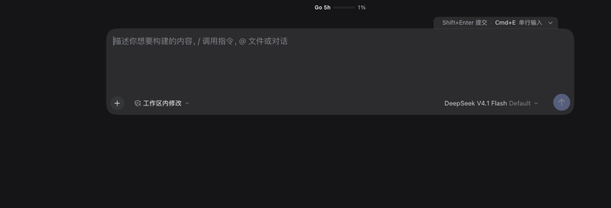

# dsh-multiline-input

> 官网 / Website: <https://dsh.zlmix.com/multiline-input/>
>
> **开发版 0.2.0**（2026-10-30，未发布）：tab 可收起、记录提交文字、↑/↓ 浏览历史；基线 DSH 0.2.1-rc.5。

[npm](https://www.npmjs.com/package/dsh-multiline-input) · [GitHub](https://github.com/ZilongYang/dsh-multiline-input) · [Release v0.1.1](https://github.com/ZilongYang/dsh-multiline-input/releases/tag/v0.1.1) · [市场 PR #9938](https://github.com/awesome-dsh-plugin/awesome-dsh-plugin/pull/9938)

把 DeepSeek Harness 的对话输入框在**单行 / 多行**之间切换的 Web 客户端插件。

- 默认快捷键 **Cmd+E（macOS）/ Ctrl+E（Windows / Linux）**；输入框上沿有一个与输入框同底色的小 **tab** 显示当前快捷键与目标模式，点击即可切换。
- 多行模式输入框默认 **4 行高**（3–5 行区间内），内容变多自动长高，到原生 336px 上限后滚动。
- 多行模式 **Enter 换行、Shift+Enter 发送**；单行模式保持 DSH 原生行为（Enter 发送、Shift+Enter 换行）。
- 输入框上沿的 tab 可**收起成一条 8px 细线**，把高度让给正文；点击细线随时恢复，收起状态按设备记住。
- 提交过的文字会记入**设备侧输入历史**：单行模式 `↑` / `↓`、多行模式 `Shift+↑` / `Shift+↓` 回看并替换，`Esc` 还原浏览前草稿；失败/被拒的提交不会入历史。
- 快捷键可在 **设置 → 通用 → 快捷键**里改成任意组合（冲突校验、恢复默认都由 DSH 官方界面负责）。
- 模式按设备记住，刷新 / 重启后保持。




## 安装

```sh
# 市场 / CLI 管理的 profile
dsh plugin --profile <profile> add dsh-multiline-input

# 或在应用内「插件」页搜索 / 用绝对路径安装后启用
```

桌面版使用的 `desktop` profile 由应用独占（`dsh plugin --profile desktop` 会被拒绝），请在应用「插件」页安装或手动 link：

```sh
cd ~/.dsh/profiles/desktop
pnpm add link:/absolute/path/to/dsh-multiline-input
# 再把 "dsh-multiline-input" 追加到 package.json 的 dsh.profile.bundles
```

启用后刷新页面即可；插件清单变化不需要重启应用。

**卸载**：插件页关闭 / 卸载，或 `dsh plugin --profile <profile> remove dsh-multiline-input`。

## 使用

| 操作 | 单行模式 | 多行模式 |
|---|---|---|
| `Enter` | 发送 | 换行 |
| `Shift+Enter` | 换行 | 发送 |
| `Cmd/Ctrl+Enter` | 加速提交（不变） | 加速提交（不变） |
| `↑` / `↓` | 浏览输入历史 | 原生移动光标 |
| `Shift+↑` / `Shift+↓` | 原生扩展选择 | 浏览输入历史 |
| `Esc`（浏览中） | 还原浏览前草稿 | 还原浏览前草稿 |
| `/`、`@` 菜单打开时的 `Enter` | 选中菜单项 | 选中菜单项 |
| 输入法候选态的 `Enter` | 交给输入法 | 交给输入法 |

- 按 `Cmd+E` / `Ctrl+E`（或点击 tab）在两种模式间循环；切换不清空草稿、不抢焦点。
- tab **默认常驻**，输入文字时也不隐藏；多行时显示 `Shift+Enter 提交 · Cmd+E 单行输入`，单行时显示 `Cmd+E 多行输入`；浏览历史时标签位改为 `历史 n/m`。
- tab 是输入框上方**独立的一行**：展开态 24px；点击右侧收起按钮变成 8px 细线（仍在流内，输入区回收约 16px），点击细线恢复。无论展开还是收起，目标条、待办、队列、额度横条等 DSH 卡片都排在它上面，不会被遮住。
- 收起/展开状态按设备持久化（`dsh-multiline-input.hint.v1`）；收起后 `Cmd/Ctrl+E` 仍照常切换。

### 输入历史

- 只记录 **Host 接受**的普通消息；`/` 命令、空提交、失败或被拒绝的提交、超过 16000 字符的单条都不会入历史。
- 设备侧 `localStorage`（`dsh-multiline-input.history.v1`）全局一份，按最近提交排序，完全相同的文字会去重置顶；上限 200 条 / 10 万字符。
- 浏览时首次 `↑` 会把当前草稿存起来：`Esc` 或在新条目上再按 `↓` 会还原并退出浏览；直接打字 / 粘贴 / 剪切则退出浏览、保留当前文字；提交后从头开始。
- **清空入口**：在「设置 → 通用 → 快捷键」搜索「清空输入历史」，给 `multiline-input.clear-history` 绑一个组合即可（默认不占用任何键）。
- 历史是设备本地明文，可能包含敏感内容；换设备不会同步，多窗口之间也不实时同步。

## 修改快捷键

1. 打开 **设置 → 通用 → 快捷键**；
2. 搜索「多行输入」（命令名：**切换多行输入**，id `multiline-input.toggle`）；
3. 点击右侧键位进入录制，按下新组合即可；冲突时官方界面会提示，可随时恢复默认。

tab 实时跟随当前生效的组合；把绑定清空后只显示「多行输入 / 单行输入」，点击仍可切换。

## 与相近插件的区别

| 插件 | 它做什么 | 本插件 |
|---|---|---|
| `dsh-composer-expand` | 工具行按钮把输入框撑到 70vh | 双模式 + 快捷键 + Enter/Shift+Enter 互换 + 常驻 tab |
| `dsh-fullscreen-input` | 另开全屏面板写多行，Enter 换行、Ctrl+Enter 发送 | 内联在原生输入框，多行时 Shift+Enter 发送（带输入法保护） |
| `dsh-ctrl-enter-submit` | 全局把 Enter 改成换行、Ctrl/Cmd+Enter 发送 | 单行保持原生 Enter 发送，多行才交换 |
| `dsh-composer-ux` | 可配置发送/换行键位 + 右键菜单 + 快捷指令面板 | 只专注输入模式与高度 |
| `dsh-keyboard-manager` | Ctrl+Q / **Ctrl+E** / Ctrl+S 切栏、开设置 | Windows/Linux 上它的 Ctrl+E 与本插件默认冲突；可在设置里改键（macOS 本插件用 Cmd+E，不冲突） |

## 实现说明

插件遵守 DSH 的第三方客户端插件契约（`dsh.client` + `dsh.bundle.patch`），Host 半只保留一个可安装 / 启停的 bundle row，功能全部在 `client.js`：

- **模式状态**：模块级 store + `localStorage['dsh-multiline-input.mode.v1']`，投影为 `<html data-dsh-ml-input="multi">`；
- **高度**：一条 CSS 规则给 `[data-composer-card] [data-composer-input][contenteditable="true"]` 设 `min-height: calc(4 * 1lh + 8px)`，不碰 DSH 的滚动上限；
- **tab 提示**：注册到 `conversation.input.dock` 座位（`order: 1000`，排在 todo 0 / 额度横条 5 / 目标条 10 / 队列 20 之后），成为输入卡片正上方**独立的一行**：展开 24px、收起 8px，宽度与卡片同列、tab 右对齐到卡片右边缘；`margin-bottom` 吃掉栈的行距（dock 态 6px、hero 态 8px，运行时按实际 `row-gap` 同步），让 tab 底边与卡片上沿齐平、视觉上仍是「卡片肩上的 tab」，但因为占位而**不可能压到任何上方卡片**；收起态靠同一行 8px 高度 + 抵消行距把输入区回收约 16px。
- 旧实现走 `conversation.input.overlay` 浮层（`bottom: 100%` + `z-index: 2`），会盖住目标条右侧的文案与暂停 / 编辑 / 清除按钮；
- **输入历史**：轮询 `useInput(s => s.phase/draft)` 与 `useSession(s => s.pendingSubmissions)`。rc.5 / rc.3 的提交回显是**乐观**的（提交时出现、失败时移除并回填草稿），所以提交时先记下草稿、待回显退休时若草稿没有回填才写入 `localStorage`；0.2.2-alpha 起存在 `sending` 冻结相位，则直接用冻结草稿 + 接受回显，更精确。浏览时通过公开的 `inputActions.setDraft()` 替换草稿（`setDraft` 会合并进撤销历史），方向键手势仍在 document 捕获阶段接管。
- **Enter / Shift+Enter**：在 document 捕获阶段拦下多行模式下的 `Enter`，向编辑器重放一个翻转了 `shiftKey` 的合成按键——仍由 DSH 自己的 composer keymap 决定「换行」还是「提交」，撤销历史、输入法保护、busy-enter（queue/steer）、菜单仲裁全部保持原逻辑；
- **快捷键**：通过 `ctx.shortcuts.register()` 注册命令，编辑与持久化完全交给 DSH。

源码依据（DSH `0.2.1-rc.5`，commit `31cfe2aafe`）：

| 契约 | 源码文件 |
|---|---|
| 输入卡片 / 覆盖层锚点 | `packages/client/ui-conversation/src/client/skeleton/InputBar.tsx`、`InputBar.module.css` |
| composer 卡片栈（`conversation.input.dock`） | `packages/client/ui-conversation/src/client/skeleton/ConversationContent.tsx`、`ConversationRoot.module.css` |
| 可编辑面 / 占位符 | `packages/client/ui-conversation/src/client/input/editor/DraftEditor.tsx`、`ComposerContentEditable.tsx` |
| Enter 语义 | `packages/client/ui-conversation/src/client/input/editor/keymap.ts` |
| 公开输入动作面 | `packages/client/ui-conversation/src/client/contract/input.ts` |
| 座位与标准 props | `packages/client/ui-conversation/src/client/contract/slots.ts`、`packages/extensions/cordis-client-runner/src/client/slot-catalog.ts` |
| 快捷键命令契约 | `packages/client/shortcuts/src/client/types.ts`、`binding.ts` |
| 客户端清单 | `packages/util/package-manifest/src/types.ts`、`packages/client/modules/README.zh.md` |

## 兼容性

- 在 DSH **0.2.1-rc.5**（桌面版 / Web）验证；`dsh.compatibility.dsh` = `>=0.2.1-rc.5 <0.3.0-0`。
- 依赖 composer 的 `data-*` 锚点与 `role="listbox"`，属 DSH 内部实现；升级 DSH 后需要回归（锚点缺失时插件只 warn，不会崩）。
- tab 行的宽度与右对齐复用了 DSH 布局变量 `--dsh-composer-card-max-width` / `--dsh-composer-side-clearance`（都带兜底值），若 DSH 改了输入区宽度算法，tab 会与卡片右边缘错开几像素。
- Web + Linux 没有默认快捷键（DSH 对 Web 可选组合有白名单限制），需在设置里自行指定。

## 开发

```
dsh-multiline-input/
├── package.json            # dsh.bundle.patch + dsh.client(platform: web)
├── cordis.patch.yml        # 1 个 Host row
├── index.js                # Host 半（空实现，仅为 bundle 契约）
├── client.js               # Client 半（手写，无构建、无第三方依赖）
├── icon.svg / assets/      # 插件图标与市场截图
├── locale/{zh,en}.json     # 插件展示元数据
├── test/                   # node --test
└── docs/                   # 计划、发版清单
```

- 测试：`npm test`（`node --test`，当前 28 条用例）。
- 语法：`node --check client.js && node --check index.js`。
- 调试：HMR 默认忽略 `**/node_modules`，链接安装的 `client.js` 改动不会被热加载；改完客户端代码后在插件页关/开一次（或重启应用），再刷新页面。

## 发版

一次发版四步，缺一不可（2026-10-29 明确要求：**新版本必须同步官网** `https://dsh.zlmix.com/multiline-input/`）：

1. **校验**：`node --test`、`node --check client.js && node --check index.js` 全绿；`package.json` 版本号、`CHANGELOG.md`、README / ROADMAP 的版本与链接写对。
2. **GitHub**：`git tag vX.Y.Z && git push origin main --tags`；`gh release create vX.Y.Z --title "…" --notes-file …`。
3. **npm**：`npm publish`（账号 `zlmix`）。本机沙箱下先设 `npm_config_cache=/tmp/dsh-npm-cache npm_config_logs_dir=/tmp/dsh-npm-logs`，否则 npm 写不了 `~/.npm/_logs`；发布后回读 `https://registry.npmjs.org/dsh-multiline-input/X.Y.Z`（registry 约 30s 后生效）和 tarball 里的 `client.js`。
4. **官网**：在 `~/zWork/ai/zl-plugins/site` 同步下面四处，`node scripts/check-site.mjs` 通过后 `./scripts/deploy.sh`（脚本会先备份线上、再上传并逐路由验证 + 校验 `index.html` 与线上 sha256）：

| 官网位置 | 改什么 |
|---|---|
| `data/plugins.json` | 该插件的 `version`、`released`，以及 `site.updated` |
| `multiline-input/index.html` | JSON-LD `softwareVersion`、hero `data-version`、`pkg-line`、版本 chip；实现描述有变化时同步正文 |
| `index.html` | 插件卡 `data-version`、版本 chip、JSON-LD `softwareVersion` |
| `sitemap.xml` | 首页与该插件页的 `lastmod` |

每次发版的打勾清单存到 `docs/RELEASE-CHECKLIST-<版本>.md`，并在上面的文档索引与 ROADMAP 里挂链接。站点自检若撞上**其它插件仓库「版本号已 bump、npm 未发」的中途**，用 `CHECK_SITE_SKIP_CROSS=<package>` 显式跳过那一条（跳过只留 warning），并在清单里记一笔原因。

## 已知限制

- 仅作用于 Web GUI（桌面版与浏览器），TUI / CLI 不适用。
- 多行起始高度是代码常量 4 行，暂不提供配置项（0.2.1 计划改为 Host Config）。
- 输入历史是设备本地 `localStorage` 明文（全局一份），可能包含敏感内容；用「设置 → 快捷键 → 清空输入历史」清空。多窗口之间不做实时同步。
- rc.5 / rc.3 的失败判定是启发式（提交回显退休时草稿被回填即视为失败）：若在回显退休前手动改写失败草稿，可能误记一条；0.2.2-alpha 的 `sending` 相位不存在这个问题。
- 0.2.0 在 DSH 0.2.1-rc.5 验证（`sending` 相位是 0.2.2-alpha 才有的，rc.5/rc.3 用乐观回显 + 失败草稿回填判定，已按同一 `pendingSubmissions` 契约核对）；rc.3 上收起与方向键同样可用。
- tab 行展开态占输入框上方 24px（输入区比没有 tab 时高约 18px，24px 行高抵掉 6px 栈间距）；收起态 8px（净高约 2px），输入区回收约 16px。
- hero（空会话）状态下栈行距是 8px，tab 行会按运行时读到的实际 `row-gap` 自适应，视觉上与 dock 态一致。
- 若默认键位与其它插件的命令默认值冲突，插件会降级为「点击 tab 切换」并在控制台输出一次警告。

## 文档

- [实施计划（2026-10-30）](docs/PLAN-2026-10-30.md)
- [实施计划（2026-10-27）](docs/PLAN-2026-10-27.md)
- 发版检查清单：[0.1.1](docs/RELEASE-CHECKLIST-0.1.1.md)、[0.1.0](docs/RELEASE-CHECKLIST-0.1.0.md)
- [路线图](ROADMAP.md)
- [变更记录](CHANGELOG.md)

## License

MIT
